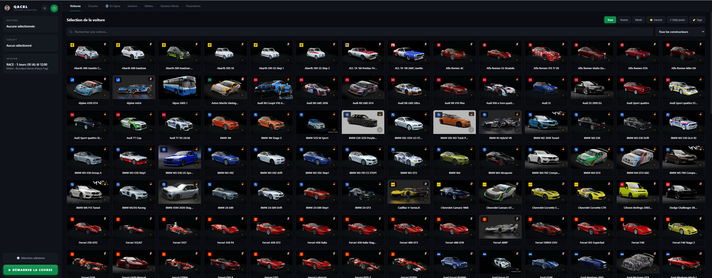
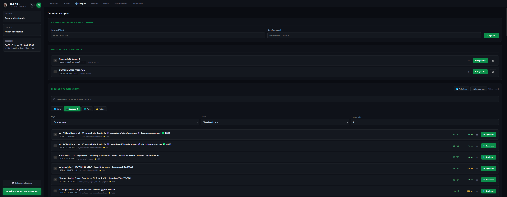
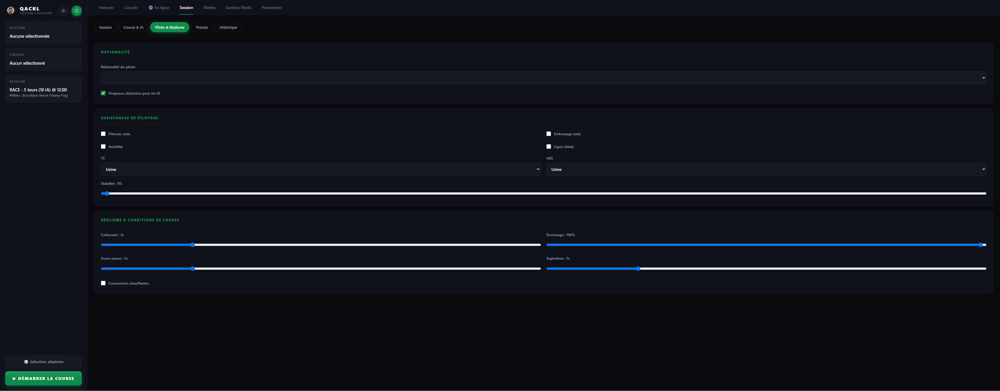
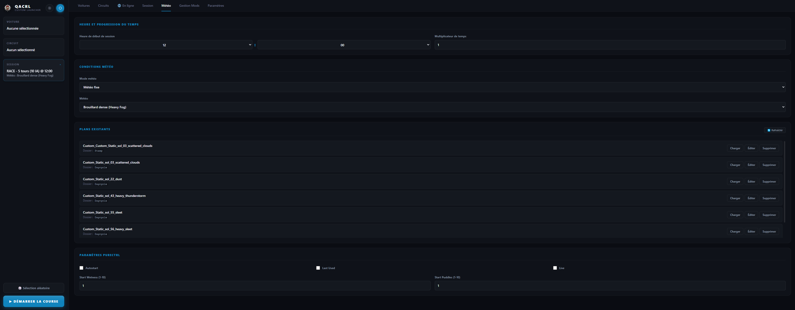
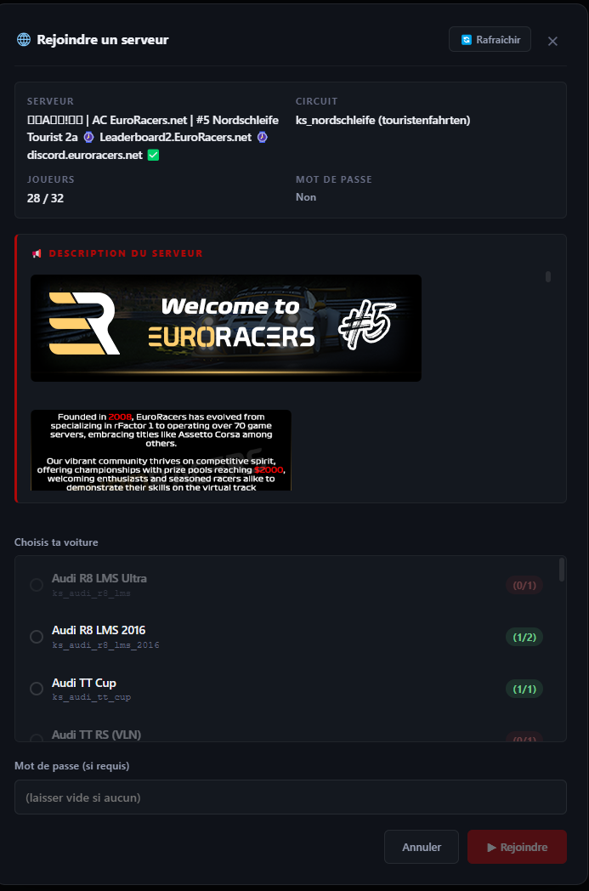
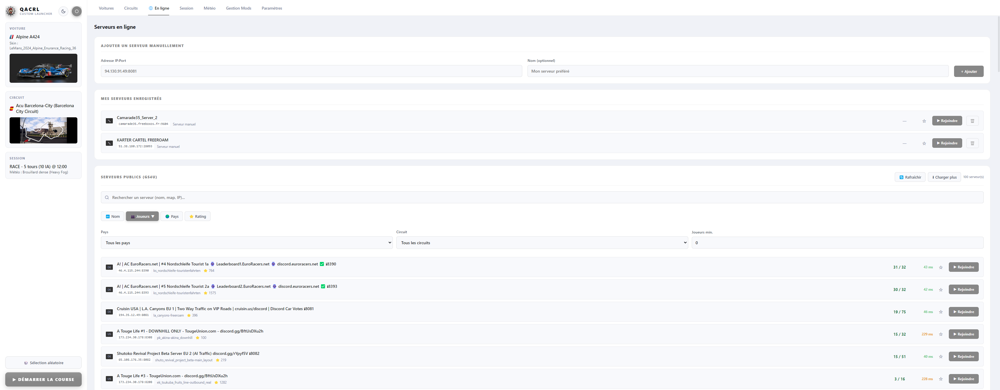

<div align="center">


# QACRL — Quick Assetto Corsa Race Launcher

**Un launcher custom léger, moderne et rapide pour Assetto Corsa**

[](https://github.com/camarade35/QACRL_Quick-AC-Race-Launcher/releases)
[](https://www.electronjs.org/)
[](https://github.com/camarade35/QACRL_Quick-AC-Race-Launcher/releases)
[](LICENSE)
[](https://github.com/camarade35/QACRL_Quick-AC-Race-Launcher/releases/latest)
[](https://github.com/camarade35/QACRL_Quick-AC-Race-Launcher/releases)

[Fonctionnalités](#-fonctionnalités) • [Installation](#-installation) • [Captures d'écran](#-captures-décran) • [Avertissements](#️-avertissements-connus) • [Contribuer](#-contribuer)

</div>

---

## 📖 À propos

**QACRL** (Quick Assetto Corsa Race Launcher) est un launcher alternatif pour Assetto Corsa, pensé pour les joueurs qui veulent **lancer une session en quelques clics** sans passer par le launcher officiel ni Content Manager.

Il se concentre sur **l'essentiel** : choix voiture + circuit + session, configuration météo, et surtout **la connexion rapide aux serveurs en ligne**.

### 🎯 Pourquoi QACRL ?

- ⚡ **Rapide** — démarre en moins d'une seconde
- 🎨 **Interface moderne** — thème sombre/clair, accent personnalisable
- 🌐 **Serveurs en ligne intégrés** — GS4u scraping + serveurs manuels
- 🚀 **Rejoindre un serveur en 2 clics** — écriture automatique du `race.ini`
- 📦 **Gestion des mods** — glisser-déposer pour installer
- 🎮 **Compatible AssettoServer & Kunos** — détecte automatiquement le type de serveur

---

## ✨ Fonctionnalités

### 🚗 Sélection voiture & circuit
- Parcours complet de votre `content/cars` et `content/tracks`
- Recherche instantanée + filtres (Kunos / Mods / Favoris / Déjà joués)
- **Filtres par tags** avec popup interactive
- Sélection de la livrée (skin) et de la variante de circuit
- Logos constructeurs + drapeaux automatiques
- Favoris ⭐ et compteur de sessions

### ⚙️ Configuration de session
- Type de session : **Practice / Race / Hotlap**
- Durée, tours, nombre d'adversaires
- Grille IA : voitures identiques / même classe / même marque / aléatoire
- **Réglages IA** : niveau ± variance, agressivité ± variance
- Assistances : TC, ABS, stabilité, autoclutch, autoblip, ligne idéale, etc.
- Réalisme : usure pneus, carburant, dommages, aspiration
- **Nationalité du pilote** + drapeaux aléatoires pour les IA

### 🌦️ Météo avancée
- **Météo fixe** — sélection parmi toutes les conditions Kunos / SOL / Pure
- **Plans Pure Planner existants** — chargement depuis `extension/config-ext/PurePlanner`
- **Plans personnalisés** — création d'une timeline météo multi-étapes
- Paramètres **pureCtrl** (autostart / last used / live)
- **Heure de départ** + multiplicateur de temps
- Calcul automatique des angles soleil (`SUN_ANGLE`) pour `[RACE]` et `[LIGHTING]`

### 🌐 Serveurs en ligne
- **Scraping GS4u** — liste de 300+ serveurs publics
- **Filtres** : pays, circuit, joueurs min
- **Tri** : nom, joueurs, pays, rating
- **Ping en arrière-plan** (6 threads parallèles)
- **Favoris serveurs** ⭐
- **Ajout manuel** de serveurs par IP:Port
- **Détection AssettoServer** via `/api/details` (fallback Kunos `/INFO` + `/ENTRY`)
- **Description BBCode** convertie en HTML (liens cliquables, images)
- **Features CSP** affichées en badges
- **Bouton Rafraîchir** sans fermer la modale
- **Détection des mods manquants** avec bouton 🔍 (DuckDuckGo) et 📋 (copier)
- **Auto-suffixe du nom en ligne** si déjà pris
- **Support CSP Custom Update** — injection automatique de `__FEATURES`

### 📦 Gestion des mods
- **Drag & drop** d'archives (.zip, .rar, .7z, .tar.gz)
- Détection automatique voiture / circuit / apps / extension / system
- Barre de progression détaillée
- Gestion des conflits (remplacer / passer / annuler)
- **Historique d'installation** avec prévisualisations
- Suppression de mods depuis l'historique

### 🎨 Interface
- **Thème sombre / clair** avec bouton toggle
- **Couleur d'accent** personnalisable (color picker)
- Animations fluides et transitions
- Sidebar récap (voiture / circuit / session / météo)
- Sélection aléatoire 🎲 (voiture + skin + circuit + variante)

### 🎮 Multi-comptes
- **Auto-détection du SteamID** depuis `loginusers.vdf` (fallback `race.ini`)
- Gestion des noms pilote / en ligne séparés
- Détection du dossier Documents automatique

---

## 📸 Captures d'écran

<div align="center">

| 🚗 Sélection voiture | 🌐 Serveurs en ligne |
|---|---|
|  |  |

| ⚙️ Configuration session | 🌦️ Météo & Plans |
|---|---|
|  |  |

| 🎯 Rejoindre un serveur | 🎨 Thème clair |
|---|---|
|  |  |

</div>

---

## 🚀 Installation

### Prérequis

- **Windows 10/11** (64-bit)
- **Assetto Corsa** installé via Steam
- **7-Zip** installé (recommandé pour extraire les mods .rar/.7z)
- **Node.js 18+** (pour build depuis les sources)

### Téléchargement

**Option 1 — Binaire pré-compilé** (recommandé)

Télécharge la dernière release : [Releases](https://github.com/camarade35/QACRL_Quick-AC-Race-Launcher/releases)

**Option 2 — Depuis les sources**

```bash
# Cloner le repo
git clone https://github.com/camarade35/QACRL_Quick-AC-Race-Launcher
cd qacrl

# Installer les dépendances
npm install

# Lancer en mode développement
npm start

# Ou packager pour la distribution
npm run build
```

### Configuration au premier lancement

1. Lance QACRL
2. Onglet **Paramètres** → clique sur **Parcourir...** pour le dossier d'Assetto Corsa
3. Vérifie que le **Steam ID** est bien détecté (sinon clique sur 🔍 Détecter)
4. C'est prêt !

---

## ⚠️ Avertissements connus

### Message CSP « Failed to decrypt model »

Sur certaines voitures moddées (notamment celles des créateurs `mnba_*`, `ms_*`, `vrc_*`...), **Custom Shaders Patch** peut afficher au chargement un message du type :

> **Failed to decrypt model**
> `content/cars/xxx/xxx.kn5`
> • Inappropriate environment.
> Would you want to continue?

**Ce message est inoffensif.** Clique simplement sur **« Oui »** pour continuer, et le modèle se charge correctement.

#### Pourquoi ce message apparaît ?

Certains modèles `.kn5` sont **chiffrés** par les créateurs de mods pour protéger leur travail. Pour les déchiffrer, CSP a besoin d'un contexte Steam précis (`SteamAppId`, `SteamGameId`).

Content Manager masque ce message car il utilise un **starter interne** (`AppIdStarter`) qui initialise complètement l'environnement Steam avant de lancer `acs.exe`. QACRL lance `acs.exe` directement, ce qui peut déclencher ce message sur certains mods.

#### Solutions

- **Simple** : cliquer sur « Oui » et continuer — le modèle fonctionne normalement.
- **Alternative** : lancer une fois le jeu via Content Manager avant d'utiliser QACRL (fonctionne temporairement).

#### Ce qui a été essayé (sans succès)

- Définir les variables d'environnement `SteamAppId=244210` et `SteamGameId=244210` dans le `spawn` de `acs.exe`
- Créer un fichier `steam_appid.txt` dans le dossier d'installation
- Lancer via `steam://rungameid/244210` → supprime le message mais **empêche le join multijoueur** (le `race.ini` n'est plus lu correctement)

Le warning est codé en dur dans CSP et n'est **pas désactivable** via `general.ini` (à part désactiver complètement l'intégration Steam, ce qui bloque le multijoueur).

---

## 🤝 Contribuer

Les contributions sont les bienvenues ! Voici comment :

1. **Fork** le projet
2. **Crée une branche** (`git checkout -b feature/ma-feature`)
3. **Commit** tes changements (`git commit -m 'feat: ajouter une feature'`)
4. **Push** sur la branche (`git push origin feature/ma-feature`)
5. **Ouvre une Pull Request**

### Signaler un bug

Ouvre une [issue](https://github.com/camarade35/QACRL_Quick-AC-Race-Launcher/issues) en précisant :

- Version de QACRL
- Version de Windows
- Version de CSP
- Étapes de reproduction
- Logs éventuels (`main.js` ou `race.ini`)

---

## 📄 License

Ce projet est sous licence **MIT** — voir le fichier [LICENSE](LICENSE) pour plus de détails.

---

## 🙏 Remerciements

- **Kunos Simulazioni** pour Assetto Corsa
- **Peter Boese (x4fab)** pour Custom Shaders Patch
- **La communauté AC** pour les mods, les serveurs et les outils

---

<div align="center">

**Fait avec ❤️ pour la communauté Assetto Corsa**

[⬆ Retour en haut](#qacrl--quick-assetto-corsa-race-launcher)

</div>